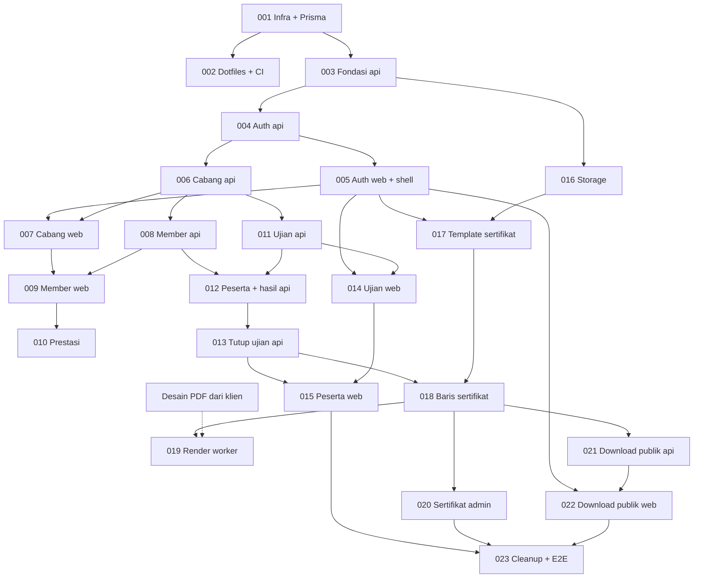

# Tiket pengembangan fase 1

Kumpulan tiket untuk membangun fase 1 aplikasi manajemen klub karate. Setiap tiket ditulis supaya
bisa dikerjakan oleh AI coding agent atau junior programmer tanpa harus bertanya konteks dari awal.

Dokumen ini adalah **rencana kerja**, bukan sumber aturan domain. Aturan domain tetap di
[`docs/requirements.md`](../requirements.md) dan keputusan teknis di
[`docs/architecture.md`](../architecture.md). Jika tiket dan kedua dokumen itu berbeda, dokumen
itulah yang benar; laporkan perbedaannya ke user.

## Cara memakai tiket

1. Pilih tiket berstatus **Todo** yang semua dependency-nya sudah **Done** (lihat tabel di bawah).
2. Baca berurutan: `AGENTS.md` root, `docs/requirements.md`, `docs/architecture.md`, aturan folder
   yang disentuh (`apps/web/AGENTS.md` atau `apps/api/README.md`), lalu tiketnya sendiri.
3. Buat branch `feat/tkt-NNN-<ringkas>` (contoh `feat/tkt-006-branches-api`) dari `main` terbaru.
4. Kerjakan langkah di tiket **berurutan**. Jangan mengerjakan hal di bagian "Tidak termasuk".
5. Jalankan semua perintah di bagian "Cara verifikasi". Semua harus lolos.
6. Ubah kolom **Status** di tabel indeks (dan di tiketnya) menjadi `Review`, lalu buka PR.
   Status menjadi `Done` setelah PR di-merge.
7. Jika menemukan aturan domain yang belum dijawab dokumen: **berhenti di bagian itu dan tanya
   user**. Jangan menebak. Bagian lain tiket boleh dilanjutkan.

Status yang dipakai: `Todo`, `In progress`, `Review`, `Done`, `Blocked` (sebutkan alasannya).

## Indeks dan urutan

| No                                              | Judul                                         | Area     | Bergantung pada      | Status |
| ----------------------------------------------- | --------------------------------------------- | -------- | -------------------- | ------ |
| [TKT-001](TKT-001-verify-infra-and-prisma.md)   | Verifikasi infra lokal dan Prisma             | infra/db | -                    | Review |
| [TKT-002](TKT-002-dotfiles-ci-first-commit.md)  | Dotfiles, CI GitHub Actions, commit awal      | infra    | 001                  | Review |
| [TKT-003](TKT-003-api-foundation.md)            | Fondasi api: Prisma, validasi, error, paging  | api/db   | 001                  | Review |
| [TKT-004](TKT-004-auth-api.md)                  | Auth Super Admin (api)                        | api      | 003                  | Review |
| [TKT-005](TKT-005-auth-web-and-shell.md)        | Login dan kerangka dashboard (web)            | web      | 004                  | Review |
| [TKT-006](TKT-006-branches-api.md)              | Modul cabang (api)                            | api      | 004                  | Done   |
| [TKT-007](TKT-007-branches-web.md)              | Fitur cabang (web)                            | web      | 005, 006             | Done   |
| [TKT-008](TKT-008-members-api.md)               | Modul member dan riwayat tingkatan (api)      | api      | 006                  | Done   |
| [TKT-009](TKT-009-members-web.md)               | Fitur member (web)                            | web      | 007, 008             | Done   |
| [TKT-010](TKT-010-achievements.md)              | Prestasi member (api + web)                   | api/web  | 009                  | Done   |
| [TKT-011](TKT-011-exams-api.md)                 | Modul event ujian dan penguji (api)           | api      | 006                  | Review |
| [TKT-012](TKT-012-exam-participants-api.md)     | Peserta, biaya, dan hasil ujian (api)         | api      | 008, 011             | Review |
| [TKT-013](TKT-013-finish-exam-api.md)           | Menutup ujian dan riwayat tingkatan (api)     | api      | 012                  | Review |
| [TKT-014](TKT-014-exams-web.md)                 | Fitur event ujian (web)                       | web      | 005, 011             | Review |
| [TKT-015](TKT-015-exam-participants-web.md)     | Peserta, hasil, dan tutup ujian (web)         | web      | 013, 014             | Review |
| [TKT-016](TKT-016-storage-module.md)            | Modul storage MinIO/S3 (api)                  | api      | 003                  | Review |
| [TKT-017](TKT-017-certificate-templates.md)     | Template sertifikat (api + web)               | api/web  | 005, 016             | Review |
| [TKT-018](TKT-018-certificate-records.md)       | Baris sertifikat, penomoran, terbit ulang     | api      | 013, 017             | Review |
| [TKT-019](TKT-019-certificate-render-worker.md) | Render sertifikat PDF + PNG (apps/worker)     | worker   | 018 + A12-A14        | Review |
| [TKT-020](TKT-020-certificates-admin-web.md)    | Daftar dan unduh sertifikat admin (web + api) | api/web  | 018 (unduh: 019)     | Review |
| [TKT-021](TKT-021-public-download-api.md)       | Download sertifikat publik (api)              | api      | 018 (uji penuh: 019) | Todo   |
| [TKT-022](TKT-022-public-download-web.md)       | Halaman download sertifikat publik (web)      | web      | 005, 021             | Todo   |
| [TKT-023](TKT-023-cleanup-and-e2e.md)           | Hapus contoh products, E2E alur utama         | web/docs | 015, 020, 022        | Todo   |

### Grafik dependency

Jalur yang bisa paralel setelah TKT-004: **cabang/member** (006 sampai 010), **ujian** (011 sampai
015), dan **storage/template** (016, 017). TKT-019 desainnya sudah diterima (lanskap), tinggal jawaban A12 sampai A14; tiket lain
tidak perlu menunggu desain.

## Keputusan klien (16 sampai 17 Oktober 2026)

Ringkasan dari `docs/requirements.md` dan handoff 17 Oktober. Sudah final, jangan diubah tanpa
persetujuan user.

- Fase 1 hanya satu aktor: **Super Admin**. Publik hanya bisa mengunduh sertifikat.
- Sabuk berurutan: putih, kuning, hijau, biru, cokelat, hitam. Tidak ada rentang kyu per warna.
- Kyu 10 sampai 0. Member baru: putih, kyu 10. Default turun 1 per ujian lulus; boleh 0.5, 2,
  atau lebih (diisi admin per peserta).
- Sabuk hitam hanya setelah kyu 0. Setelah hitam, tingkatan dan juga diujikan (default naik 1).
- Hasil ujian hanya lulus atau tidak lulus. Raport dan komponen nilai ditunda.
- Tanpa syarat absensi atau durasi latihan. Tanpa NIK.
- Biaya ujian fleksibel: default per event, bisa ditimpa per peserta. Status bayar: belum, lunas,
  dibebaskan.
- Nomor anggota dibuat sistem. Data lama diinput manual (tidak ada import Excel).
- Sertifikat: satu desain PDF A4 untuk semua jenis ujian, ditandatangani ketua club saja. File
  desain menyusul dari klien. Output **PDF vektor** dan **PNG 300 DPI**, dirender sekali lalu
  disimpan.
- Download publik tanpa login: nomor anggota + tanggal lahir, hanya sertifikat terbaru, rate limit
  per IP, pesan gagal yang sama untuk semua kasus.

## Asumsi yang belum dikonfirmasi

Tiket memakai **nilai default** di bawah supaya pekerjaan tidak berhenti. Semua default dibuat di
satu tempat (konstanta atau fungsi) agar mudah diganti. Setelah user mengonfirmasi, perbarui
`docs/requirements.md` dan tabel ini.

### Dari handoff 17 Oktober

| ID  | Asumsi                                                                 | Dipakai di    |
| --- | ---------------------------------------------------------------------- | ------------- |
| A1  | Warna sabuk baru dipilih manual oleh admin per peserta, bukan dihitung | 012, 015      |
| A2  | Nilai kyu berkelipatan 0.5 (10, 9.5, 9, ... 0)                         | 008, 012, 013 |
| A3  | Field member minimal: tanpa gender, foto, atau data wali               | 008, 009      |

### Ditemukan saat menyusun tiket (perlu ditanyakan ke user)

| ID  | Pertanyaan                                                                | Default yang dipakai tiket                                                                                        |
| --- | ------------------------------------------------------------------------- | ----------------------------------------------------------------------------------------------------------------- |
| A4  | Saat member pertama kali mendapat sabuk hitam, dan-nya berapa?            | **Terjawab (18 Okt):** langsung `dan = 1`. Hitam selalu punya dan ≥ 1                                             |
| A5  | Hitam boleh dipilih di ujian yang sama saat kyu hasil menjadi 0?          | **Terjawab (18 Okt): pakai default.** Boleh. Syaratnya kyu **hasil** ujian = 0 (bukan kyu sebelum ujian)          |
| A6  | Bolehkah warna sabuk turun (mis. hijau ke kuning)?                        | **Terjawab (18 Okt): pakai default.** Tidak. Warna baru harus sama atau lebih tinggi urutannya                    |
| A7  | Bolehkah satu member terdaftar di dua ujian yang belum selesai sekaligus? | **Terjawab (18 Okt): pakai default.** Tidak. Ditolak saat pendaftaran                                             |
| A8  | Ujian bisa ditutup jika masih ada peserta tanpa hasil atau belum bayar?   | **Terjawab (18 Okt): pakai default.** Semua peserta wajib punya hasil. Status bayar tidak menghalangi             |
| A9  | Member cocok tetapi belum punya sertifikat: pesan apa di halaman publik?  | **Terjawab (18 Okt): pakai default.** Pesan umum yang sama dengan data tidak cocok                                |
| A10 | Format nomor anggota dan nomor sertifikat                                 | **Terjawab (18 Okt):** tanpa tanda hubung: `M202600001`, `C202600001`                                             |
| A11 | Penurunan kyu yang membuat kyu di bawah 0                                 | **Terjawab (18 Okt): pakai default.** Ditolak (bukan dibulatkan ke 0)                                             |
| A12 | Desain punya isian "Ranting", sedangkan data member hanya punya cabang    | **Terjawab (18 Okt): pakai default.** Ranting tidak dicetak (tetap titik-titik) sampai user menjawab              |
| A13 | Desain memuat "Depok, 31 Maret 2026" sebagai teks tetap                   | **Terjawab (18 Okt): pakai default.** Dibiarkan apa adanya di PDF; tanggal terbit tidak ditimpa sampai user jawab |
| A14 | Teks isian "sabuk ..." (mis. "kuning kyu 9", "hitam dan 2")               | **Terjawab (18 Okt): pakai default.** `<warna> <kyu N>` atau `hitam dan <N>` huruf kecil; user perlu konfirmasi   |

## Konvensi bersama untuk semua tiket

Tiket merujuk bagian ini supaya tidak diulang di setiap file.

### Kontrak HTTP (api)

- Semua endpoint di bawah prefix `/api`. Nama resource bahasa Inggris, jamak: `/api/branches`,
  `/api/members`, `/api/exams`.
- List memakai query `page` (mulai 1) dan `pageSize` (default 20, maksimal 100), dan mengembalikan
  bentuk yang sama dengan tipe `Paginated<T>` di `apps/web/src/types/api.ts`:
  `{ data: T[], meta: { page, pageSize, total, totalPages } }`.
- Error memakai body `{ message: string, ... }` (bentuk bawaan NestJS), karena `api-client` web
  membaca `message`. Pesan dalam bahasa Indonesia. Validasi gagal: 400 dengan detail per field.
  Tidak ditemukan: 404. Melanggar aturan bisnis: **409** (`ConflictException`), ditetapkan di
  TKT-003.
- Tanggal tanpa jam (tanggal lahir, tanggal ujian) dikirim sebagai string `YYYY-MM-DD`. Waktu
  lengkap sebagai ISO 8601.
- Nilai `Decimal` Prisma (kyu) dikirim sebagai `number` (contoh `9.5`), bukan string atau objek.
- Field enum dikirim apa adanya dari skema (`COACH`, `KYU`, `PAID`, dan seterusnya). Label bahasa
  Indonesia dibuat di web.

### Struktur kode api

- Satu folder per domain: `apps/api/src/<domain>/` berisi `<domain>.module.ts`,
  `<domain>.controller.ts`, `<domain>.service.ts`, `dto/*.ts` (schema Zod), dan `*.spec.ts`.
- Aturan bisnis murni (perhitungan kyu, validasi sabuk, transisi status) ditulis sebagai fungsi
  murni di file terpisah (contoh `exams/grade-rules.ts`) dan diuji tuntas tanpa database.
- Tulis ke lebih dari satu tabel selalu di dalam `prisma.$transaction`.
- Import relatif memakai ekstensi `.js`. Env hanya lewat `loadEnv()`.

### Struktur kode web

- Ikuti `apps/web/AGENTS.md`, `apps/web/docs/adding-a-feature.md`, dan contoh
  `src/features/products`. Untuk Claude Code ada skill `new-feature`.
- Fitur tidak boleh import fitur lain. Jika fitur member butuh daftar cabang untuk dropdown, buat
  fungsi API sendiri di `features/members/api/` (contoh `get-branch-options.ts`).
- Semua teks UI bahasa Indonesia.

### Git dan definition of done

- Commit Conventional Commits, contoh `feat(api): tambah modul cabang`. Satu tiket boleh beberapa
  commit, satu PR.
- Sebelum PR: `pnpm check` dan `pnpm format:check` lolos dari root.
- Tidak ada `console.log`, kode mati, atau TODO tanpa konteks. Logika baru punya test.
- Perubahan aturan domain atau arsitektur dicatat di `docs/` pada PR yang sama.

## Menambah tiket baru

Salin [`_TEMPLATE.md`](_TEMPLATE.md), beri nomor berikutnya, lalu tambahkan ke tabel indeks dan
grafik dependency.
